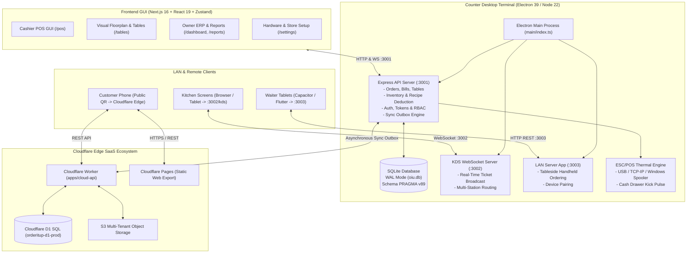
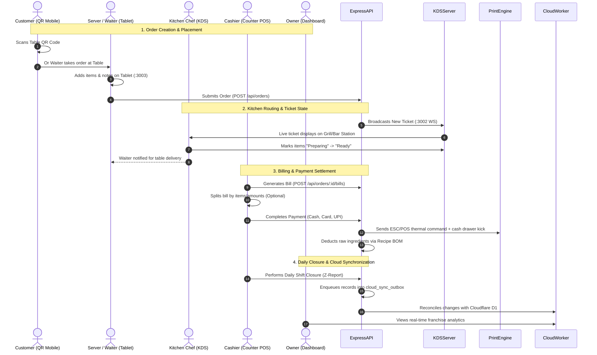

# Order It Up: Architecture & Team Developer Guide

Welcome to the Order It Up engineering team! This document serves as the master onboarding and technical guide for developers, system architects, and maintainers working across the Order It Up ecosystem.

---

## 1. Executive Summary & Core Philosophy

**Order It Up** is an offline-first, enterprise-grade restaurant Point of Sale (POS), Kitchen Display System (KDS), and restaurant ERP platform.

### Core Invariants

1. **100% Offline-First Resilience**: All core restaurant operations—taking orders, kitchen ticket routing (KDS/KOT), bill calculation, split payments, and thermal receipt printing—must function flawlessly without an active internet connection.
2. **Backend Authority**: Security-critical calculations (tax rates, discounts, loyalty ledger balances, inventory deductions, token verification) are strictly backend-authoritative. Clients never dictate financial totals.
3. **Data Safety & Zero Data Loss**: Existing customer databases must survive upgrades unconditionally. We never reset, drop, or truncate merchant databases. SQLite auto-backups execute automatically prior to any migration step.
4. **Decoupled Architecture**: UI display language, tenant country settings, and tax/compliance rules are decoupled into separate domains.
5. **Cross-Platform Portability**: All scripts, tests, and build tools must execute cleanly across Windows, macOS, and Linux.

---

## 2. System Architecture & Topology

Order It Up combines a high-performance local Electron runtime, an Express micro-services backend, a Next.js touchscreen frontend, and a serverless Cloudflare Workers cloud tier.



### Local Multi-Port Architecture

| Port | Service Name | Protocol | Purpose |
| :--- | :--- | :--- | :--- |
| **`:3001`** | **Core Express POS API** | HTTP & WS | POS backend, SQLite access, staff authentication, order state machine, billing, inventory deductions, offline sync outbox. |
| **`:3002`** | **Standalone KDS Server** | HTTP & WS | Kitchen Display System server. Allows any tablet or smart TV on the LAN to load `/kds` and receive real-time ticket updates via WebSockets. |
| **`:3003`** | **Server / Waiter App Server** | HTTP | Handheld tableside ordering server. Interfaces with waiter tablets running the Capacitor wrapper or mobile web. |
| **`:3004`** | **Landing / Marketing Web** | HTTP | Standalone static Next.js application for SaaS landing, customer onboarding, and Windows installer downloads. |

---

## 3. The Multi-Agent Restaurant Lifecycle

Order It Up orchestrates interactions across six distinct operational personas:



### Role Breakdown

1. **Customer (Public QR)**:
   - Browses live digital menu, selects variants and add-on groups.
   - Places orders linked to specific table tokens.
   - Tracks preparation status without requiring native app installs.
2. **Server / Waiter (Mobile / Tablet)**:
   - Interacts with interactive floorplan, marks table occupancy.
   - Takes orders tableside, captures special dietary notes, fires orders directly to the kitchen.
3. **Kitchen Chef (KDS Screens)**:
   - Receives instant ticket alerts categorized by kitchen station (Main, Grill, Bar, Dessert).
   - Transitions orders: `RECEIVED` → `PREPARING` → `READY`.
4. **Cashier (Counter Terminal)**:
   - Fast counter ordering and barcode lookup.
   - Full split-billing engine (split by item, percentage, or custom amount).
   - Direct thermal receipt printing and automated cash drawer kick.
5. **Kitchen Manager / Stock Controller**:
   - Manages recipe Bills of Materials (BOM).
   - Real-time stock reservation and automatic ingredient deduction upon bill completion.
6. **Franchise Owner / Manager**:
   - Audits shift cash closures, discount authorisations, voided items, and staff attendance.
   - Accesses multi-branch consolidated reports and financial metrics.

---

## 4. Database Architecture & Migration System

Order It Up uses local **SQLite** configured in Write-Ahead Logging (`WAL`) mode with foreign key enforcement (`PRAGMA foreign_keys = ON;`).

### Database Files & Paths
- **Database File**: `oiu.db` (formerly `flo.db`) stored in the application user data directory (or root during development).
- **Auto-Backups**: Stored in `backups/oiu-backup-<timestamp>-pre-v<from>-to-v<to>.db`.
- **Database Module**: Managed entirely in `main/db.ts`.

### Schema Migrations (`v1` to `v89`)
The database tracks schema state using `PRAGMA user_version`. When the app boots:
1. `initDatabase()` opens the SQLite database.
2. It inspects `PRAGMA user_version`.
3. If `user_version < CURRENT_VERSION` (currently `89`):
   - An automated snapshot backup is created immediately before any alteration.
   - Each incremental migration transaction (`applyMigrationV...`) runs sequentially.
   - `PRAGMA user_version` is bumped to the target version upon completion.
   - Built-in SQLite `integrity_check` and `foreign_key_check` verify consistency.

### Rules for Adding New Migrations (`v90+`)
1. **Never mutate existing migration functions**: Migrations `v1` through `v89` are historical records. Never edit them.
2. **Define a new migration function**: Create `applyMigrationV90(db: Database.Database)` in `main/db.ts`.
3. **Wrap in a transaction**: All DDL and DML operations must execute within a database transaction.
4. **Never drop tables with user data**: Use column additions, view alterations, or non-destructive tables.
5. **Update test fixtures**: Update `tests/db-audit.test.ts` and verify with `npm run audit:db`.

---

## 5. Offline-First Synchronization & Outbox Engine

When offline, Order It Up guarantees continuous local operations. All remote operations are queued using the **Transactional Outbox Pattern**:

```text
Local Transaction:
[ Insert Order / Payment ] + [ Insert into cloud_sync_outbox ] (Atomic commit)
                                          │
                                   Background Worker
                                          │ (Check network)
                                  Online? ├── No ──> Exponential backoff & retry
                                          │
                                         Yes
                                          ▼
                         POST /api/cloud/sync (Cloudflare D1)
                                          │
                                     200 OK Response
                                          ▼
                       Mark outbox row synced / Purge
```

- **Idempotency Keys**: Both `order_idempotency` and `payment_idempotency` tables prevent duplicate transaction execution on network timeouts or retries.
- **Conflict Resolution**: Local counter operations are authoritative for shift transactions; Cloudflare D1 manages cross-branch analytics aggregation.

---

## 6. ESC/POS Thermal Printing Subsystem

Order It Up supports direct hardware receipt and Kitchen Order Ticket (KOT) printing without operating system print dialogs:

- **Connectivity Options**:
  - **USB**: Direct raw communication with POS printers via vendor/product IDs.
  - **Network (TCP/IP)**: Direct socket connection to port `9100` on network receipt printers.
  - **System Spooler**: Fallback to Windows/macOS native driver print spoolers.
  - **Web Popup / WebUSB**: Fallback for browser-only preview and testing.
- **Paper Formats**:
  - `58mm` (32 characters per line).
  - `80mm` (42 or 48 characters per line).
- **Hardware Integration**:
  - Cash drawer kick pulse (`ESC p 0 25 250`) triggered automatically on cash payments.
  - Paper cut command (`GS V 66 0`) after receipt footer.

---

## 7. Developer Quickstart & Day-to-Day Operations

### Prerequisites
- **Node.js**: `v22.12.0` or later (verify with `node -v`).
- **npm**: `v10+` (verify with `npm -v`).
- **Git**: Installed with Git Bash on Windows.

### Installation
```bash
# Clone the repository
git clone <repository-url>
cd order-it-up

# Install root dependencies
npm install

# Install sub-project dependencies
cd frontend && npm install && cd ..
cd apps/cloud-api && npm install && cd ..
cd landing && npm install && cd ..
```

### Common Commands Cheatsheet

```bash
# === Development ===
npm run dev              # Launch complete Electron app (cleans ports, builds frontend & backend)
node dev-server.js       # Start Express API (:3001), KDS (:3002), and Server App (:3003) only
npm run dev:frontend     # Run Next.js frontend in browser development mode

# === Building ===
npm run build            # Compile TypeScript backend (dist/)
npm run build:frontend   # Export Next.js static desktop frontend (frontend/out)
npm run build:web        # Export static cloud web export for Cloudflare Pages

# === Linting & Validation ===
npm run lint             # Run ESLint on both backend (main/) and frontend (frontend/)
npm run audit:db         # Run full SQLite database schema & migration integrity audit
npm run i18n:check       # Validate translation keys and parity across all 8 locales
npm run check:cloud-ready # Verify remote Cloudflare Worker readiness

# === Testing ===
npm run pretest          # Run split-checks and release regression test suites
npm run test:dev-tooling # Run dev-tooling and sharding tests
npm run test:smoke       # Run dual-server application smoke test
npm run verify:platform  # Run comprehensive multi-suite platform verification
```

---

## 8. Code Review, Safety & Contribution Rules

1. **PR Review Quotas**: Batch automated feedback fixes into single, consolidated commits. Do not push one commit per review finding.
2. **Conventional Commits**: Use conventional prefixes: `feat:`, `fix:`, `refactor:`, `test:`, `docs:`, `ci:`.
3. **No Secrets**: Never commit `.env` files, credentials, or private keys.
4. **Cross-Platform Test Execution**: Use `node tests/run-test.cjs <command>` for test commands to ensure clean execution across Windows, macOS, and Linux.
